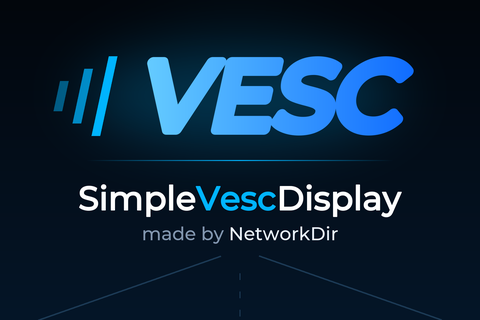
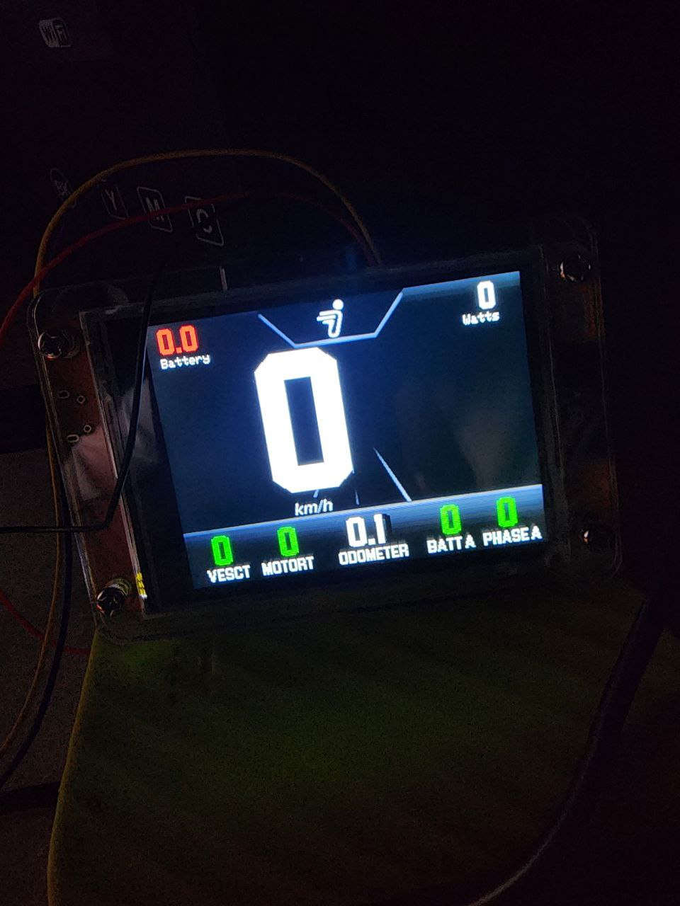

# 🚀 Simple VESC Display v2

> **Credits:** based on the original project by [Gh0513d/SVD](https://github.com/Gh0513d/SVD) 🔗

A touch dashboard for VESC based e‑scooters, e‑bikes and boards, running on cheap
ESP32 "Cheap Yellow Display" boards. Version 2 is a complete rewrite on **LVGL 9** and
**LovyanGFX**: one code base for the 2.8" **and** the 3.5" boards, talking to the VESC over
**UART, CAN or Bluetooth LE** – and it can replace the VESC's Bluetooth module, so VESC Tool
on your phone connects *through* the display.

<p>


</p>

> Looking for the old TFT_eSPI version (v1)? It is kept unchanged in the [`old`](old/) folder.

| Folder | Content |
|---|---|
| [`firmware/`](firmware/) | v2 firmware (Arduino sketch + `lv_conf.h`) |
| [`old/`](old/) | original v1 firmware and its libraries |
| [`tools/`](tools/) | build script, font and boot logo generators |
| [`3d_models/`](3d_models/) | housing and mounts |

## ✨ Features

**Dashboard & touch UI**
- Big anti-aliased speed (optional decimal) with max/avg, range/efficiency or odometer/ride-time line
- Battery % (Li-ion or LiFePO4 curve, filtered) + voltage, power (W/A), power/regen bar, **duty-cycle bar**
- **5 configurable cells** – choose from 17 values (temperatures, currents, power, voltage, battery %,
  duty, trip, odometer, range, Wh/km, Wh, Ah, ride time, avg/max speed); long press a cell to change it
- 5 pages – swipe or use the arrows: **Dash · Trip stats · Live data · Charts · Settings**
- Live charts of the last 60 s (speed/power, currents, temperatures, voltage/duty)
- Everything is configurable on the screen and stored in flash
- Back to the dashboard automatically when riding, optional dimming when standing still

**Connectivity**
- **UART** (default) – same wiring as v1
- **CAN** – ESP32 TWAI + 3.3 V transceiver; VESC id auto-detect, bus scan, falls back to CAN status messages
- **BLE link** – connect to an existing VESC BLE module (when the VESC UART is already used by it)
- **BLE bridge for VESC Tool** – the display replaces the NRF BLE module (custom name, optional 6‑digit PIN)
- **Dual motor** – second VESC on CAN (via `COMM_FORWARD_CAN` in UART mode)
- Non-blocking protocol implementation (the v1 library could freeze the screen for 100 ms per request)

**Safety, data & hardware**
- Warnings: VESC faults (by name), ESC/motor temperature, low/empty/over battery, speed, high duty –
  on screen, RGB LED and beeper (speaker connector)
- CSV ride log on the micro‑SD card · odometer and (optional) trip kept across restarts
- Auto brightness with the light sensor (adjustable), touch calibration, demo mode without a VESC
- Own boot logo from the SD card – no rebuild needed

| Board | Screen | Touch | PlatformIO env / Arduino define |
|---|---|---|---|
| ESP32‑2432S028R | 2.8" 320×240 ILI9341 | resistive | `esp32-2432s028r` / `BOARD_ESP32_2432S028R` |
| ESP32‑2432S028R (2×USB) | 2.8" 320×240 ST7789 | resistive | `esp32-2432s028r-st7789` / `BOARD_ESP32_2432S028R_ST7789` |
| ESP32‑3248S035R | 3.5" 480×320 ST7796 | resistive | `esp32-3248s035r` / `BOARD_ESP32_3248S035R` |
| ESP32‑3248S035C | 3.5" 480×320 ST7796 | capacitive (GT911) | `esp32-3248s035c` / `BOARD_ESP32_3248S035C` |

## 🖐️ Touch actions

| Where | Action |
|---|---|
| anywhere | swipe left / right → next / previous page |
| battery (top left) | tap → big value % ↔ volts |
| power (top right) | tap → watts ↔ battery amps |
| speed | tap → MAX·AVG / RANGE·Wh/km / ODO·RIDE TIME |
| a bottom cell | **long press** → choose what it shows (+ *Reset trip* on the trip cell) |
| top centre notch | tap → statistics |
| page title | tap → back to the dashboard |
| during the boot logo | touch → touch calibration |

## 🔌 Wiring

| Board | Connector | UART RX/TX or CAN RX/TX |
|---|---|---|
| ESP32‑2432S028R | CN1: GND · IO22 · IO27 · 3V3 | **RX = IO22**, **TX = IO27** (same as v1) |
| ESP32‑3248S035R/C | P3: GND · IO35 · IO22 · IO21 | **RX = IO35**, **TX = IO22** |

Power the board with 5 V (e.g. VESC 5 V → board 5 V/VIN) and always connect **GND**.

**UART** – display RX ← VESC TX, display TX → VESC RX. In VESC Tool *App Settings → General → App to Use*
must include **UART**, baud rate **115200** (or whatever you select on the display).

**CAN** – needs a 3.3 V CAN transceiver (SN65HVD230, TJA1051T/3, …):
```
display RX pin ── transceiver R / CRX        transceiver CANH ── VESC CANH
display TX pin ── transceiver D / CTX        transceiver CANL ── VESC CANL
3V3, GND       ── transceiver VCC, GND       120 Ω termination at both bus ends
```
VESC default bit rate is 500 kbit/s; *VESC CAN ID = AUTO* finds the VESC. For the status-message fallback
enable *App Settings → General → CAN Status Message Mode* in VESC Tool.

**BLE link** – *Interface = BLE*: the display connects to the nearest VESC BLE module and remembers it once
the module answers like a VESC (other "Nordic UART" gadgets nearby are skipped). *Settings → Bluetooth →
Forget* to pair another one.

**BLE bridge** – *Settings → Bluetooth → VESC Tool bridge = on*, restart, then scan in VESC Tool for
**"VESC SVD xxxx"** (or the name you set). With *Bridge needs PIN* the phone asks once for the PIN shown on the display.

## 📥 Installation

### Arduino IDE
1. Boards Manager: **esp32 by Espressif** (2.0.17 or 3.x).
2. Library Manager: **LovyanGFX** (≥ 1.2.7), **lvgl** (9.1 … 9.6), **NimBLE-Arduino** (≥ 2.2.3).
3. Copy `firmware/lv_conf.h` to `Documents/Arduino/libraries/lv_conf.h` (next to the `lvgl` folder –
   back up an existing one; the build stops with a clear message if the wrong or an older file is used.
   **Updating from 2.0.0: copy it again**).
4. Open `firmware/SimpleVescDisplay/SimpleVescDisplay.ino`, select your board in `src/config/board_config.h`.
5. Tools → **ESP32 Dev Module**, Partition Scheme **Huge APP (3MB No OTA/1MB SPIFFS)** → Upload
   (hold **BOOT** if the upload does not start).

### PlatformIO
```bash
pio run -e esp32-3248s035c -t upload
```

### Prebuilt binaries
Merged images (`*_merged.bin`, see [Releases](../../releases)) can be flashed at address **0x0** with
<https://espressif.github.io/esptool-js/> or `esptool.py write_flash 0x0 <file>`.

The odometer of v1 is imported automatically on the first start.

### ⏱️ Faster builds
- The first build compiles LVGL (≈ 5 min), later builds only recompile changed files (≈ 30 s) – keep the
  IDE open and do not change `lv_conf.h` unless needed.
- Each board compiles only the fonts it uses; unused LVGL widgets are disabled in `lv_conf.h`.
- On Windows, excluding the Arduino build folder (`%LOCALAPPDATA%\arduino`) from the antivirus real-time
  scan typically makes builds 2–3× faster.

## 🖼️ Own boot logo

- **No rebuild:** copy `splash.png` or `splash.jpg` (max 100 KB, any size – scaled to fit, 480×320 /
  320×240 look best) to the root of the SD card.
- **Built in:** `python tools/images/png2header.py my_logo.png firmware/SimpleVescDisplay/src/ui/images/splash_png.h`
- **Edit the default logo:** texts and colours are at the top of `tools/images/make_splash.py`.
- *Settings → Display → Boot logo* switches it off.

## ⚙️ Settings

| Section | Options |
|---|---|
| Connection | interface (UART/CAN/BLE), UART baud, CAN bit rate, VESC CAN id (AUTO), display CAN id, 2nd VESC id, poll rate, CAN scan |
| Bluetooth | VESC Tool bridge, PIN pairing, device name, forget paired devices |
| Vehicle | motor poles, wheel diameter, gear ratio, speed correction %, battery type, cells, capacity |
| Dashboard | the 5 cells, speed decimal, power bar scale, start page |
| Units & warnings | km/h·mph, °C·°F, speed / temperature / duty / low battery limits, beeper, speed beep, touch sound, RGB LED |
| Display | auto brightness (LDR) with minimum level and dark threshold (live sensor value), brightness, idle dimming, rotate 180°, invert colours, swap red/blue, back to dash while riding, boot logo, touch calibration |
| Data | keep trip after restart, SD logging, set odometer, reset trip, demo mode |
| System | info, free memory, restart, factory reset (keeps the odometer) |

Compile-time defaults: `src/config/app_config.h` · pins: `src/config/board_config.h`.

## 🛠️ Troubleshooting

| Problem | Fix |
|---|---|
| colours look negative | Settings → Display → *Invert colours* |
| red and blue swapped | Settings → Display → *Swap red/blue* (restart) |
| touch is offset | touch the screen while the boot logo is shown → calibrate |
| "NO VESC LINK" | swap RX/TX, check GND and baud rate, *App to Use* must include UART |
| CAN: nothing found | 3.3 V transceiver, CANH/CANL not swapped, 120 Ω termination, bit rate |
| BLE stays on "scanning" | close VESC Tool on the phone (a VESC BLE module accepts one connection), disable the pairing PIN of a VESC Express |
| image noise | lower `TFT_SPI_FREQ` in `board_config.h` (e.g. 27000000) |
| display restarted by itself | after the restart a message shows why; also *Live data → Last restart* / *Settings → System*. **brownout** = the 5 V supply dips (use a better DC/DC converter or shorter, thicker wires); **crash** = please open an issue with the USB serial log |

The USB serial port (115200 baud) prints diagnostics, including free memory and the reason of the last restart.

## 🔄 Changes since v1

- New UI on LVGL 9, 3.5" support, one code base for all boards, everything configurable on the screen
- Own non-blocking VESC protocol (UART / CAN / BLE) instead of ComEVesc, BLE bridge for VESC Tool
- **Distance fix:** v1 used *motor revolutions / 1000* as kilometres (wheel size ignored); v2 uses wheel
  diameter, motor poles and gear ratio. Correct your odometer once in Settings if needed.
- Settings, odometer and trip in NVS with wear-friendly saving (every km and when stopped)

### 2.0.1 – stability
- **Fixed random restarts with Bluetooth:** the BLE scan stored every advertising device, so in crowded
  places (many phones, watches, headphones) the memory ran full and the display rebooted. The scan now
  keeps only the best VESC candidate.
- **Fixed a restart while riding:** LVGL allocated a ~13 KB buffer for the big speed digits on every
  redraw; with Bluetooth and a fragmented heap that eventually failed. A fixed glyph buffer is used now.
- Out-of-memory protection: LVGL allocates through a guard with a 16 KB reserve – a full heap closes the
  open page and dialogs with a message instead of rebooting; pages, keyboards and choosers only open when
  enough memory is free; the BLE scan and the SD card wait for memory too.
- Less RAM: smaller draw buffers (allocated before Bluetooth starts), shared styles in the settings, one
  ride mode at a time in *Settings → Ride modes*, the dashboard is no longer built twice on a theme change.
- BLE link binds only to a module that answers VESC packets; longer reply timeout over Bluetooth.
- BLE bridge: VESC Tool gets its replies even while the display polls the same data.
- Bigger loop stack, checked Bluetooth start, safe SD log buffer, dialogs keep their own action, no
  second odometer keypad on a double tap, CAN frames limited to 8 bytes, buffered UART TX (forwarding
  VESC Tool packets no longer stalls the screen), SD log file number kept in flash.
- Reason of the last restart (brownout, crash, watchdog …) on screen and in *Live data*.

## 📜 License

MIT. Fonts: Montserrat & Font Awesome (SIL OFL) as shipped with LVGL.
